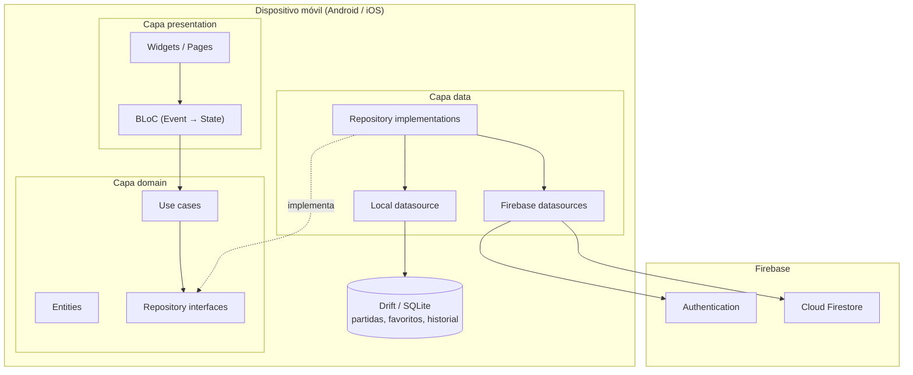

# La Pocha Tracker

> Marcador digital para el juego de cartas La Pocha — Flutter · Firebase · BLoC · Clean Architecture

[](https://flutter.dev)
[](https://dart.dev)
[](https://firebase.google.com)
[](LICENSE)
[](https://github.com/juanmigrau/la-pocha-tracker/actions)

> **Demo visual:** GIF o captura del flujo principal — se añadirá próximamente.

---

## ¿Qué es?

**La Pocha Tracker** es una app móvil Flutter que digitaliza el marcador del juego de cartas español La Pocha. Sustituye papel y lápiz por un flujo guiado que calcula puntos, valida la restricción del repartidor y conserva un historial consultable.

La partida se juega en un solo dispositivo (offline-first). El registro es opcional: al finalizar, si hay sesión y red, la partida se sincroniza con Firebase para compartir el historial entre jugadores registrados.

---

## Stack

| Área | Tecnología |
|------|------------|
| UI / lenguaje | Flutter · Dart 3.12+ |
| Estado | BLoC (`flutter_bloc`) |
| Arquitectura | Clean Architecture por feature |
| Persistencia local | Drift (SQLite) |
| Backend | Firebase Auth + Cloud Firestore |
| DI / routing | GetIt · go_router |
| CI/CD | GitHub Actions (analyze, test, APK) |

---

## Arquitectura

Clean Architecture por feature (`auth`, `game_setup`, `round`, `history`, `favorites`, `sync`, `share_result`):

- **presentation** — widgets + BLoC (eventos → estados)
- **domain** — entidades, use cases e interfaces de repositorio (Dart puro)
- **data** — implementaciones que orquestan Drift (local) y Firebase (nube)

La presentation no importa SDKs de Firebase. Durante la partida la fuente de verdad es local; la nube interviene en auth y al sincronizar partidas finalizadas.



Código de la app en `app/lib/`, con `core/` (router, DI, tema, base de datos) y `features/<nombre>/{presentation,domain,data}/`.

---

## Funcionalidades principales

- Creación de partida (3–8 jugadores), secuencia de rondas automática y elección de repartidor
- Flujo completo de ronda: apuestas → juego → bazas reales → puntos y ranking
- Validación en tiempo real de la restricción del repartidor (número prohibido)
- Corrección de apuestas en la ronda actual y repetición de ronda
- Jugadores por nombre libre, búsqueda de usuarios registrados y favoritos locales
- Historial unificado (local + nube), detalle ronda a ronda y «repetir partida»
- Compartir resultado final como imagen PNG (share sheet local con `share_plus`, sin Firebase)
- Registro / login opcional (email-contraseña y Google); sync automático al finalizar (con reintento si falla)

---

## Decisiones técnicas destacadas

| Decisión | Elegido | Alternativa | Por qué |
|----------|---------|-------------|---------|
| Estado | **BLoC** | Riverpod / setState | Flujos de ronda con muchos estados intermedios (apuestas rotativas, validación, correcciones). Eventos y estados explícitos, fáciles de probar con `bloc_test`. |
| Persistencia local | **Drift (SQLite)** | Hive / shared_preferences | Tipado fuerte, migraciones formales y BD en memoria para tests. El esquema local replica Firestore (`games` + `rounds`), lo que simplifica mappers y sync. |
| Estructura | **Clean Architecture** | App monolítica por pantallas | Dominio puro (restricción del repartidor, puntuación) independiente de Flutter/Firebase. Presentation sin SDKs remotos; TDD por capas. |
| Sync | **Offline-first + sync diferido** | Online obligatorio | Se juega sin red; Firestore solo recibe partidas **finalizadas** con sesión. Si falla la subida, `syncStatus: pending` y reintento posterior. |

---

## Capturas de pantalla

> Capturas próximamente — ver APK para demo en vivo.

---

## Instalación y ejecución local

### Requisitos

- Flutter SDK 3.x (Dart ^3.12)
- Android Studio y/o Xcode
- [Firebase CLI](https://firebase.google.com/docs/cli) y [FlutterFire CLI](https://firebase.google.com/docs/flutter/setup) (`dart pub global activate flutterfire_cli`)
- Java 17 (Gradle / Android)

### Pasos

```bash
git clone https://github.com/juanmigrau/la-pocha-tracker.git
cd la-pocha-tracker/app

flutter pub get

# Genera firebase_options.dart y google-services (no van en el repo)
firebase login
flutterfire configure --project=la-pocha-9d070 --platforms=android,ios --yes

# Código generado de Drift
dart run build_runner build --delete-conflicting-outputs

flutter run
```

### Emuladores Firebase (opcional)

Para desarrollo sin tocar producción:

```bash
# Desde la raíz del repo (donde esté firebase.json)
firebase emulators:start --only auth,firestore
```

En debug, la app puede apuntar a los emuladores Auth/Firestore (ver `ai-specs/specs/development_guide.md`).

---

## APK de demo

El workflow de GitHub Actions (`.github/workflows/ci.yml`):

- En **cada push/PR**: `flutter analyze` + `flutter test`
- En ramas distintas de `main`: APK **debug** como artifact
- En **merge a `main`**: APK **release** firmado (publicación en GitHub Releases próximamente)

**Descargar desde Actions:** pestaña [Actions](https://github.com/juanmigrau/la-pocha-tracker/actions) → workflow más reciente → artifacts.

**Compilar en local:**

```bash
cd app
flutter build apk --release
# → build/app/outputs/flutter-apk/app-release.apk
```

> Release pública próximamente.

---

## Tests

Más de 115 tests unitarios y de BLoC (`bloc_test` + mocks). Cobertura completa de BLoC: todos los BLoC/Cubits tienen test. Cubre reglas de dominio (apuestas, puntuación, sync) y flujos de presentación.

También hay tests de integración:
- Flujo completo de ronda con Drift real (sin mocks)
- Sync con Firebase Emulator

```bash
cd app

# Unitarios, widgets y BLoC
flutter test

# Integración (Drift real y Firebase Emulator)
flutter test test/integration/
```

Análisis estático:

```bash
flutter analyze --fatal-warnings
```

---

## Metodología de desarrollo

Proyecto desarrollado con **AI-assisted development** (Cursor + Claude) y **Spec-Driven Development**: especificaciones en `ai-specs/`, tickets en Jira y ramas con GitFlow. TDD por feature (test que falla → implementación → `flutter analyze` / `flutter test`) y Clean Architecture como contrato entre capas.
